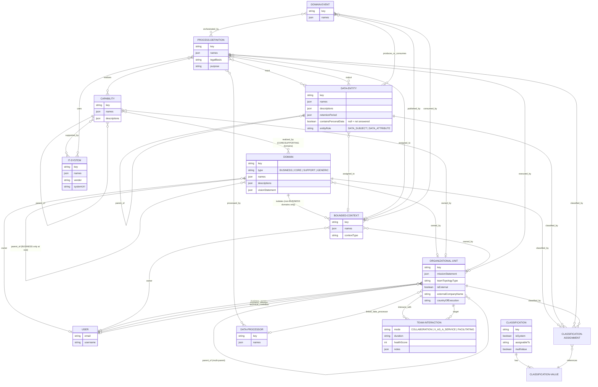

# Leargon — Core Concepts

## 1. Seven Methodologies, One Model

Leargon unifies seven methodologies inside a single data model: Data Governance, Process Governance, DSG/GDPR, Domain-Driven Design, Business Capability Modelling, Team Topologies and Lean / VSM. Each asks a different question about the organisation, yet they share the same underlying objects — domains, processes, entities, and teams — just viewed through a different lens. Each methodology can be switched on or off; a disabled methodology hides its fields, sections, to-do rules and navigation items everywhere (see `METHODOLOGY-FIELD-MAPPING.md`).

### Data Governance

Data Governance asks: *who is accountable for which data, and can it be trusted?* Every business entity has a data owner (accountable), a data steward (responsible, may edit) and a technical custodian, inherited from the owning unit when not set. It records retention periods, storage locations, classifications, interface/implementation structure, typed relationships with cardinalities, and data-quality rules. The owner verifies field values, and the owner to-do list surfaces gaps.

### Process Governance

Process Governance asks: *who is accountable for which process, and what data does it use?* Processes form a hierarchy with process owner, steward and custodian, a process type and code, input and output entities, executing org units, and a BPMN process diagram with called sub-processes.

### Domain-Driven Design (DDD)

DDD partitions an organisation's knowledge into **Bounded Contexts**: explicit boundaries inside which a consistent vocabulary (the *ubiquitous language*) is agreed and enforced. In Leargon, every Business Domain that is not a pure *Business* domain (i.e. a core, supporting, or generic domain in BCM terms) can contain one or more Bounded Contexts. Data entities and processes are assigned to a Bounded Context, which gives them their canonical meaning. Domain Events record what happened inside a context and flow to other contexts through explicit publish/consume relationships, making the Context Map machine-readable. Context relationships (Partnership, Customer–Supplier, ACL, Conformist, etc.) document the strategic coupling between teams.

### Business Capability Modelling (BCM)

BCM asks: *what must the organisation be able to do, independent of how it is structured today?* A **Capability** is a stable, named ability — "Customer Onboarding", "Order Fulfilment" — that does not change when teams reorganise. Capabilities form a tree. Processes *realise* capabilities (one process can contribute to many capabilities). IT systems *support* capabilities. Org units *own* capabilities. Leargon computes downstream views: a capability's data scope (all entities touched by its processes), its owning teams, and the IT systems it depends on.

### DSG/GDPR Compliance

Swiss revDSG and EU GDPR impose obligations at the process level: every data-processing activity must declare a legal basis, a purpose, and technical/organisational measures. Sensitive entity categories (e.g. health data) must be identified. Data processors and cross-border transfers must be registered. DPIAs must be triggered for high-risk processing. Leargon models these requirements as first-class fields on processes and entities. Whether an entity holds personal data is a typed, tri-state field (`containsPersonalData`: yes / no / not answered) together with its `entityRole` (`DATA_SUBJECT` — the person the data is about — or `DATA_ATTRIBUTE`); both are inherited from interface entities when not answered on the entity itself. Only the `special-categories` system classification (seeded at startup, locked from modification) remains classification-based — the former `personal-data` and `entity-type` system classifications were retired by migrations 070/071. The Processing Register page directly renders Art. 30 GDPR / Art. 12 revDSG-required information.

### Team Topologies

Team Topologies asks: *which teams exist, what are they for, and how do they work together?* Each org unit has a multilingual mission statement and a team type (stream-aligned, platform, enabling, complicated-subsystem). Team interactions (collaboration, X-as-a-Service, facilitating) carry a duration and a health score, and are drawn in Team Topologies notation. Insights flag interaction anti-patterns, low-health interactions and cognitive load.

### Lean / Value Stream Mapping

Lean asks: *how efficiently does work flow, and where is the waste?* Processes carry a value-stream type (operational, enabling, business support), cycle, wait and changeover time, frequency, an activity type (value-adding, business-value-added, waste) with a justification, first-pass yield and completion rate. These are rolled up into value-stream summaries.

### How They Interweave

The methodologies share structural objects but use them for different purposes:

| Object          | DDD role                              | BCM role                 | DSG/GDPR role                    |
|-----------------|---------------------------------------|--------------------------|----------------------------------|
| Bounded Context | Linguistic boundary, context map node | Unit of ownership        | Processing scope                 |
| Process         | Event producer/consumer               | Capability realisation   | Processing activity (Art. 30)    |
| Data Entity     | Ubiquitous Language noun              | Capability data scope    | Personal data category           |
| Org Unit        | Team owning a context                 | Capability owner         | Data controller / processor      |
| Classification  | Domain tag                            | Maturity/criticality tag | Special-category flag            |

| Object          | Data / Process Governance role               | Team Topologies role           | Lean / VSM role               |
|-----------------|----------------------------------------------|--------------------------------|-------------------------------|
| Bounded Context | Owner of the items placed in it              | Owned by a team (owning unit)  | —                             |
| Process         | Owned activity with data inputs/outputs      | Executed by teams              | Value-stream step with timings |
| Data Entity     | Owned, stewarded, quality-checked data asset | —                              | —                             |
| Org Unit        | Owning unit; source of inherited ownership   | Team with mission, type, interactions | Executor of value-stream steps |
| Classification  | Governance tag (e.g. confidentiality)        | —                              | —                             |

A process that reads or writes an entity containing personal data is simultaneously a governed, owned activity, a DDD *verb* (something that happens in a context), a BCM realisation (it fulfils a capability), a GDPR processing activity that must appear in the register, work executed by a team, and a step in a value stream.

---

## 2. Logical Entity-Relationship Diagram



---

## 3. Deletion Behaviour

Deletion in Leargon follows a consistent principle: **deleting an object never silently deletes unrelated objects**. Relationships are either explicitly blocked, nulled out, or cleaned up via database cascade on join tables. The rules per object type are:

### Business Domain

Deleting a domain **cascades to all its Bounded Contexts** (which are owned exclusively by the domain). Entities and processes that were assigned to those bounded contexts have their `boundedContext` reference nulled out — they survive as unassigned objects.

### Bounded Context

- Deleted together with its parent domain, or on its own by an **admin** (`DELETE /bounded-contexts/{key}`).
- Domain events **published** by the context are deleted with it.
- Entities and processes assigned to it survive with their `boundedContext` reference nulled out.

### Data Entity

- Children are **reparented to null** (they become root-level entities; their keys are recomputed).
- Interface/implementation links to other entities are **cleared from both sides**.
- Translation links are deleted.
- Entries in `process_entity_inputs` and `process_entity_outputs` join tables are **removed by DB cascade** (`ON DELETE CASCADE`). The linked processes survive but the entity is removed from their input/output sets.

### Process

- **Blocked if the process has child processes.** Returns HTTP 400. Children must be deleted or reparented first.
- **Blocked if referenced as a called element in another process's BPMN diagram.** Returns HTTP 400.
- Entries in `process_executing_units`, `process_entity_inputs`, `process_entity_outputs`, and `process_capability` join tables are removed by DB cascade.
- Any DPIA that referenced this process has its `process` FK nulled out (DPIA survives).
- Domain-event-to-process links are deleted.
- Linked IT systems, service providers, and capabilities are **not affected** — those objects survive.

### Organisational Unit

- Simple delete — **no structural guard, not even for child units**.
- The `organisational_unit_parents` join table has `ON DELETE CASCADE` on both sides (`unit_id` and `parent_id`). Deleting a parent unit removes its rows from the join table; child units **survive but become parentless** (their parent link is simply dropped). Deleting a child unit removes its own join-table rows without affecting the parent.
- Entries in `process_executing_units` are **removed by DB cascade**. Processes that had this unit as an executing unit survive with the unit removed from their `executingUnits` list.

### Capability

- Simple delete.
- Entries in `process_capability` and `it_system_capability` join tables are removed by DB cascade. Linked processes and IT systems survive.

### IT System

- Simple delete.
- Entries in `it_system_linked_processes` join table are removed by DB cascade. Linked processes survive.

### Service Provider

- Simple delete.
- Entries in `service_provider_linked_processes` join table are removed by DB cascade. Linked processes survive.

### Domain Event

- Simple delete.
- `domain_event_entity` and `domain_event_process_link` join table entries are removed by DB cascade.

### Classification / Classification Value

Deleting a classification (or a value within it) triggers an explicit cleanup pass in `ClassificationService` that removes all matching `ClassificationAssignment` entries from every entity, domain, process, and org unit that held that assignment. The owning objects survive.

---

## 4. Computed vs Explicit Relationships

### Explicit (stored in the database)

| Relationship                                     | Where stored                                                 |
|--------------------------------------------------|--------------------------------------------------------------|
| Process → Capability                             | `process_capability` join table                              |
| Domain → Bounded Context                         | `bounded_context.domain_id` FK                               |
| Domain Event → Data Entity (PRODUCES / CONSUMES) | `domain_event_entity` join table with link type              |
| Data Entity → Bounded Context                    | `business_entity.bounded_context_id` FK                      |
| Process → Data Entity (input / output)           | `process_input_entity` / `process_output_entity` join tables |
| Org Unit → Data Processor                        | `organisational_unit.linked_data_processor_id` FK            |
| Context → Context relationship                   | `bounded_context_relationship` table                         |

### Computed (derived by the backend at query time)

| Derived view                            | How derived                                                                                                              |
|-----------------------------------------|--------------------------------------------------------------------------------------------------------------------------|
| Capability's data entities              | Union of all input/output entities across all processes that realise the capability                                      |
| Capability's org units                  | Union of all executing units across all processes that realise the capability                                            |
| IT system's data entities               | Union of input/output entities of all processes that use the IT system                                                   |
| IT system's org units                   | Union of executing units of all processes that use the IT system                                                         |
| Entity's effective personal-data status | Own `containsPersonalData` / `entityRole`, else inherited from its interface entities when they all agree               |
| "Handles personal data" on process      | Any effective input or output entity (sub-process data included) has effective `containsPersonalData = true`             |
| Effective owner / steward / owning unit | Inherited through the ownership chain (see *Computed (Inherited) Ownership*)                                             |
| Ubiquitous Language per Bounded Context | All entities assigned to that context (nouns), all processes assigned (verbs), all events published or consumed (events) |
| Processing Register completeness        | Ratio of filled mandatory fields vs total mandatory fields per process                                                   |
| Conway's Law misalignment               | Processes where the executing org unit's bounded context differs from the process's bounded context                      |

---

## 5. Analytical Perspectives

### DSG/GDPR Perspective

Focuses on accountability and compliance evidence:

- **Personal data** — which entities carry personal data (typed `containsPersonalData` + `entityRole` fields) and which hold special categories (the `special-categories` system classification)
- **Legal basis per process** — Consent, Contract, Legal Obligation, Vital Interest, Public Task, Legitimate Interest
- **Purpose per process** — free-text description of the processing purpose
- **DPIA** — triggered on high-risk processes; tracks risk description, mitigation measures, residual risk, and completion status
- **Data processors** — third parties processing data on behalf of the controller; linked to processes and org units via DPA records
- **External org units** — modelled with `isExternal = true`, company name, country of execution, and linked data processor; represent cross-border transfers
- **Processing Register** — Art. 30 GDPR / Art. 12 revDSG view: one row per process with legal basis, purpose, TOM, data subject categories, processors, and cross-border transfers

### DDD Perspective

Focuses on strategic design and team autonomy:

- **Bounded contexts** — each has a ubiquitous language (entities = nouns, processes = verbs, events = domain verbs)
- **Domain events** — explicit integration points between contexts; carry produce/consume links to entities and trigger/handle links to processes
- **Context map** — relationship types (Partnership, Customer–Supplier, ACL, Conformist, OHS, Published Language, Shared Kernel, Big Ball of Mud, Separate Ways) visualised as a graph
- **Conway's Law alignment** — analytics detect when a team's home context differs from the context of the process it executes (structural misalignment)
- **CML export** — Context Mapper Language export for tooling integration

### BCM Perspective

Focuses on organisational capability and IT support:

- **Capability tree** — stable "what we do" hierarchy, independent of org structure
- **Capability realisation** — links capabilities to the processes that deliver them
- **IT system support** — which IT systems underpin which capabilities (computed via processes)
- **Org unit ownership** — which team owns which capability
- **Capability data scope** — which data entities are consumed/produced by capability-realising processes

### Governance Perspective

Focuses on data quality and stewardship:

- **Data ownership** — each entity, process, and org unit has an owner (accountable) and steward (responsible)
- **Technical custodian** — inheritable from org unit if not explicitly set
- **Classifications** — flexible tagging system (assignable to entity, process, domain, or org unit); system classifications are locked and seeded for compliance
- **Quality rules** — per-bounded-context rules with severity (MUST / SHOULD / MAY) describing data quality expectations
- **Mandatory fields** — configurable per entity type; completeness computed and surfaced in the Processing Register and on the owner's to-do list
- **Field verification** — the owner marks individual field values VERIFIED; any edit by someone else flips the field back to UNVERIFIED
- **Owner to-do list** — governance tasks derived from live data and routed to each item's effective owner and steward (see §10)

### OrgDev / Team Topologies Perspective

Focuses on team structure and process responsibility:

- **Org unit tree** — hierarchical (multi-parent) organisational structure with business owner, steward, and technical custodian; shown as a hierarchical or a container org chart
- **Mission & team type** — each unit has a multilingual mission statement and a Team Topologies type (stream-aligned, platform, enabling, complicated-subsystem)
- **Team interactions** — collaboration / X-as-a-Service / facilitating interactions with duration and health score, drawn in Team Topologies notation; anti-patterns and low-health interactions are flagged
- **Process execution load & cognitive load** — how many processes and domains each org unit carries
- **Bottleneck teams** — teams executing processes across 3 or more distinct bounded contexts
- **Wrongly placed teams** — teams where no single domain accounts for 60% or more of their processes
- **Split domains** — domains whose processes are spread across 3 or more distinct org units

### Lean / VSM Perspective

Focuses on flow efficiency of processes:

- **Value stream type** (operational / enabling / business support) and per-step **cycle time**, **wait time**, changeover time and frequency
- **Activity type** (value-adding / business-value-added / waste) with a multilingual justification
- **First-pass yield** and **completion rate**, rolled up into value-stream summaries

---

## 6. What Decides What a User Sees

Three independent mechanisms shape the UI. None of them is a frontend rule: each is computed by the backend and only rendered by the frontend.

### Methodology enablement

Each of the seven methodologies (`DATA_GOVERNANCE`, `PROCESS_GOVERNANCE`, `GDPR`, `DDD`, `BCM`, `TEAM_TOPOLOGIES`, `LEAN`) can be switched off under **Settings → Methodologies**. A disabled methodology hides its fields on every detail panel and wizard, removes its sections from Field Configuration, removes its to-do rules, and hides its navigation items (e.g. disabling `GDPR` hides the Processing Register, DPIA Register, IT Systems and Service Providers). The full field ↔ methodology mapping is in [METHODOLOGY-FIELD-MAPPING.md](METHODOLOGY-FIELD-MAPPING.md).

### Field configuration

Per entity type and field, an admin (or the lead of the field's methodology) sets visibility (`SHOWN` / `HIDDEN`), whether the field is **mandatory**, and whether it is **required at creation**. Detail responses carry `mandatoryFields`, `missingMandatoryFields` and `hiddenFields`; panels hide `HIDDEN` fields, wizards drop steps whose fields are all hidden, and the missing-fields banner groups the gaps by methodology section. A hidden field is never mandatory. Maturity presets (Basic / Advanced / Expert) apply a whole tier in one click.

### The "Current view" switcher

The top bar offers a view switcher — **Compliance**, **Architecture**, **Operations**, **Admin/Governance** — stored as the user's `preferredRole` (a temporary override can be set for the session). It is a lens, not a permission:

| View         | Extra sidebar items                                            | Team Insights sections shown                                                       |
|--------------|----------------------------------------------------------------|------------------------------------------------------------------------------------|
| Compliance   | Processing Register, Service Providers, DPIA Register, IT Systems | —                                                                               |
| Architecture | Ubiquitous Language, Context Map, Event Flow                   | Split domains, Conway's-Law alignment, bottleneck / wrongly placed teams, cognitive load, team-interaction anti-patterns and health alerts |
| Operations   | Capabilities, IT Systems                                       | Org-unit process load, bottleneck / wrongly placed teams, cognitive load, team-interaction anti-patterns and health alerts |
| Admin        | Processing Register, Service Providers, DPIA Register, Capabilities | User ownership workload                                                       |

Home, My to-dos, Team Insights, Help and the four core catalogues (Entities, Domains, Processes, Organisation) are always in the sidebar. Detail panels show the same tabs and fields in every view; field visibility is governed solely by methodology enablement and field configuration.

### Overview groupings

Every catalogue list (entities, processes, domains, org units, capabilities, IT systems, service providers) can be grouped by a dimension offered by `GET /overviews/{resourceType}/groupings` — e.g. owner, owning unit, bounded context, domain, process type, unit type, team-topology type, vendor, processing country. `GET /overviews/{resourceType}?groupBy=…` returns the grouped subtrees, with each group expandable. Dimensions backed by a disabled methodology or a hidden field are not offered.

---

## 7. Test Suite Strategy

Leargon has three test suites. Each has a distinct responsibility; nothing is tested in two places.

```
Backend Spock     →  "What does the API guarantee?"
Frontend integ.   →  "Do cross-resource mutations leave the system consistent?"
E2E Playwright    →  "Can the user complete their core task via the browser?"
```

### Layer 1 — Backend Spock specs (`leargon-backend/src/test/`)

**Owns**: every rule the API enforces.

- All HTTP status codes: 201, 200, 204, 400, 403, 404, 409
- Input validation and error messages
- Permission rules — who can create, edit, delete what
- Business logic: deletion guards, cascade nulling, version history creation
- All negative paths

**Does not test**: frontend type correctness, UI rendering, cross-resource lifecycle.

Because these tests run against an in-memory H2 database with no browser, they are fast enough to be exhaustive. This is the right place to be thorough.

### Layer 2 — Frontend integration tests (`src/tests/integration/`)

**Owns**: TypeScript API client correctness and cross-resource lifecycle.

- Round-trip tests that verify the generated TS types match the backend response shape (one create + read per resource is sufficient)
- Multi-resource scenarios: delete A → verify B survives with expected state, full lifecycle (domain → BC → entity → process → verify refs)
- Referential integrity after mutations

**Does not test**: API authorization rules (403/404/401 — those belong in Spock), single-resource update/rename variations (those are covered by the backend spec), UI rendering.

The practical rule: *if a test only calls one endpoint and checks one resource, it belongs in Spock unless its sole purpose is verifying the TypeScript client types parse correctly.*

### Layer 3 — E2E Playwright tests (`src/tests/e2e/`)

**Owns**: user-visible behaviour and role-conditional UI.

- Happy-path user journeys: open dialog → fill form → submit → see result
- Role gates: admin sees action buttons, non-admin/viewer does not
- Cross-page rendering: data set on the detail page appears correctly on the list/register page
- Diagram page loading and node interaction

**Does not test**: API authorization logic (the 403 path is Spock's job; E2E only verifies the frontend hides the controls), per-severity or per-value enumeration of enum variants (one representative value is sufficient), empty-state + filled-state for every field (one representative field per section is sufficient).

The practical rule: *one spec file per page/feature. Each file covers: admin CRUD journey + role visibility. Avoid testing the same UI pattern (field sets value → value appears) more than once per feature.*

### The layering in practice

```
Rule: "non-admin gets 403 on DELETE /processes/:key"
→ Backend Spock (ProcessControllerSpec). Not in integration or E2E.

Rule: "deleting an IT system does not delete its linked processes"
→ Frontend integration (it-system.integration.test.ts). Not in E2E or Spock.

Rule: "the Delete button is not rendered for a viewer"
→ E2E (processes-crud.spec.ts). Not in integration or Spock.
```

---

## 8. Roles, Ownership, and RBAC

Leargon has two layers of access control: **system-level roles** (coarse-grained) and **entity-level ownership** (fine-grained), plus a **realm** concept that lets owners create inside their own area. All of it is enforced server-side; the frontend renders backend-computed permission flags and holds no permission logic of its own.

---

### System-Level Roles

System roles are stored as a comma-separated string in the `User.roles` column. There are two **global** roles and a family of **methodology-scoped** roles:

| Role              | Scope           | Meaning                                                                                                                                                                                                                    |
|-------------------|-----------------|----------------------------------------------------------------------------------------------------------------------------------------------------------------------------------------------------------------------------|
| `ROLE_USER`       | global          | Every authenticated user. Reads everything. Cannot create *top-level* catalogue items by role alone, but may create inside its own realm (see *Creating Objects*) and becomes the owner of whatever it creates.   |
| `ROLE_ADMIN`      | global          | Full administrative access: edit any object regardless of ownership, manage users, and configure the system.                                                                                                               |
| `ROLE_EDITOR_<M>` | one methodology | May edit any field that belongs to methodology `<M>`, on any object, regardless of ownership. Treated as a non-owner — edits flip the field to `UNVERIFIED` and verification is not granted (see *Edit vs. Verify*).       |
| `ROLE_LEAD_<M>`   | one methodology | Everything `ROLE_EDITOR_<M>` can do **plus** managing `<M>`'s configuration — enabling/disabling the methodology and setting field visibility/mandatory for its fields. A lead implies the editor role for the same `<M>`. |

`<M>` is one of the seven methodologies — `DATA_GOVERNANCE`, `PROCESS_GOVERNANCE`, `GDPR`, `DDD`, `BCM`, `TEAM_TOPOLOGIES`, `LEAN` — so tokens look like `ROLE_LEAD_GDPR` or `ROLE_EDITOR_DDD`. The token grammar is `^ROLE_(USER|ADMIN|(LEAD|EDITOR)_<METHODOLOGY>)$`; scoped tokens are validated server-side against the known methodology keys (`RoleService`).

Roles are not hierarchical — `ROLE_ADMIN` does not imply `ROLE_USER`. In practice all admins have both, but code checks are explicit (`roles.contains("ROLE_ADMIN")`).

---

### How System Roles Are Assigned

**Signup** (`POST /authentication/signup`): always creates the user with `ROLE_USER`. No self-service promotion exists.

**Azure Entra ID login** (`POST /authentication/azure-login`): on first login the user is auto-created with `ROLE_USER` and `authProvider = "AZURE"`. Subsequent logins update the user's profile fields but never change the role — Azure group membership is **not** synced to roles.

**Admin promotion & scoped-role assignment**: only an existing `ROLE_ADMIN` can change another user's roles via the administration API (`PUT /administration/users/{id}` with a `roles` array). This is also how methodology-scoped `ROLE_EDITOR_<M>` / `ROLE_LEAD_<M>` tokens are granted; unknown tokens are rejected (400). Ordinary users cannot change their own role.

**Fallback administrator**: a special bootstrap account created at startup from the `ADMIN_EMAIL` / `ADMIN_USERNAME` / `ADMIN_PASSWORD` environment variables. It has `ROLE_ADMIN` and `isFallbackAdministrator = true`. It cannot be deleted, disabled, or have its password changed via the regular API. It can use password-based login even when Azure authentication is configured for all other users.

---

### Entity-Level Ownership Roles

Each content object carries named ownership fields that confer edit permission on that specific object only. These are **not global roles**.

| Object type         | Primary owner field                        | Secondary fields                           |
|---------------------|--------------------------------------------|--------------------------------------------|
| Business Entity     | `dataOwner`                                | `dataSteward`, `technicalCustodian`        |
| Process             | `processOwner`                             | `processSteward`, `technicalCustodian`     |
| Organisational Unit | `businessOwner` (**required**, never null) | `businessSteward`, `technicalCustodian`    |
| Business Domain     | `owner`                                    | — (steward inherited from the owning unit) |
| Bounded Context     | `owner`                                    | — (steward inherited from the owning unit) |

The creator of an entity, process or org unit is set as its primary owner at creation time.

**Stewards grant edit rights.** The *effective steward* of an object (`dataSteward` / `processSteward` / `businessSteward`, falling back to the owning unit's `businessSteward`) can edit it exactly like the owner — with one exception: a steward **cannot verify fields**, and because a steward is not the owner, every field they change flips to `UNVERIFIED` (see *Edit vs. Verify*). `technicalCustodian` remains informational and confers no edit permission.

**Domains** are edited by their effective owner or steward, an admin, or a `DDD` editor/lead. The domain owner may also manage the domain's context relationships and domain events. Deleting a domain stays with admins and `DDD` editors/leads.

Reassigning the owner/steward fields themselves is an `ROLE_ADMIN` action — except that, since those fields are mapped to the `DATA_GOVERNANCE` / `PROCESS_GOVERNANCE` methodologies, an editor/lead for the relevant methodology can also set them via the single-field endpoints.

---

### Computed (Inherited) Ownership

If an object has no explicit owner (or steward) set, the system derives one from the object's position in the model:

```
domain:           effective owner = first non-null (owner ?? owningUnit.businessOwner) up the parent-domain chain
bounded context:  effective owner = owner ?? owningUnit.businessOwner ?? domain.effectiveOwner

entity / process:
  effective owning unit = explicit owningUnit ?? boundedContext.owningUnit ?? boundedContext.domain.owningUnit
  effective owner       = explicit owner   ?? effectiveOwningUnit.businessOwner
  effective steward     = explicit steward ?? effectiveOwningUnit.businessSteward
```

The computed owner/steward are treated identically to explicit ones for permission checks and for routing to-do tasks. Clearing an explicit owner is only permitted when a computed owner already exists (so the object never becomes ownerless).

---

### Creating Objects — Realm-Based

Creation is decentralised: responsible people create inside their own **realm** without a central modelling team. `CreationPolicyService` is the single decision point for every create *and* every move (re-parenting, changing bounded context or owning unit).

**Global grants** — an admin, or an `ROLE_EDITOR_<M>` / `ROLE_LEAD_<M>` of the item type's governing methodology, may create anywhere, including top-level and unplaced items:

| Item type                                                              | Governing methodology `<M>` |
|------------------------------------------------------------------------|-----------------------------|
| Business Entity                                                        | `DATA_GOVERNANCE`           |
| Business Process                                                       | `PROCESS_GOVERNANCE`        |
| Service Provider, IT System                                            | `GDPR`                      |
| Capability                                                             | `BCM`                       |
| Business Domain, Bounded Context, Context Relationship, Domain Event   | `DDD`                       |
| Organisational Unit                                                    | `TEAM_TOPOLOGIES`           |

**Realm grants** — CREATE only; editing the new item is governed by its own ownership afterwards:

| Realm           | Who                                                         | May create                                                                                                   |
|-----------------|-------------------------------------------------------------|--------------------------------------------------------------------------------------------------------------|
| Domain          | Effective owner of the domain or any ancestor domain        | Subdomains, bounded contexts, and everything a bounded-context owner may create in them                      |
| Bounded context | Effective owner of the context                              | Entities and processes in the context, domain events it publishes, context relationships (own side)          |
| Item            | Effective owner/steward of an entity, process or capability | Its children                                                                                                 |
| Org unit        | Business owner/steward of the unit                          | Sub-units (not transitive into content), IT systems the unit owns; entities/processes it owns only while `DDD` is disabled |

A sub-unit needs rights on *every* requested parent, so nobody can pull a foreign unit under their own to widen their realm. Moving an entity or process to another bounded context needs creation rights at the destination (`DDD` editors/leads are exempt — assigning contexts is DDD work).

Configuration items — classifications, supported locales, users — remain **admin-only** to create.

**Guard rails at creation:**

- **Required at creation** — fields configured as *required at creation* must be supplied, otherwise the create endpoint answers `422 REQUIRED_AT_CREATION_MISSING`.
- **Duplicate prevention** — `DuplicateCandidateService` compares the proposed names (all locales, camelCase-aware word matching) with existing items. A likely duplicate in the same container is rejected with `409` unless the user acknowledges the candidates and gives a justification; the same term in another bounded context is suggested as a translation link instead. `GET /creation/duplicate-candidates` lets the wizard warn before submitting.
- **Atomic create** — an entity can be created together with its parent, bounded context, interfaces and a first relationship in one request.
- **Realm-owner review** — every realm-based creation writes an `item_creation_records` row (who, under which grant, any duplicate justification). The realm owner gets a *Review a new item created in your area* to-do (`REVIEW_REALM_CREATION`), closed by `POST /creation/reviews/{recordId}/acknowledge`.

The UI never decides on its own: `GET /creation/capabilities` (what the user may create at all), `GET /creation/targets` (where), and the `creatableChildTypes`, `canEdit` and `canDelete` flags on detail responses are all derived from the same policy.

---

### Permission Matrix

| Operation                                       | `ROLE_USER` (no role) | Effective steward | `ROLE_EDITOR_<M>` / `ROLE_LEAD_<M>` | Owner | `ROLE_ADMIN`       |
|-------------------------------------------------|:---------------------:|:-----------------:|:-----------------------------------:|:-----:|:------------------:|
| Read any object                                 |           ✓           |         ✓         |                  ✓                  |   ✓   |         ✓          |
| Create a *top-level* item (becomes owner)       |           ✗           |         ✗         |           ✓ (item's `<M>`)³         |   —   |         ✓          |
| Create inside a realm (becomes owner)⁴          |           ✗           |  ✓ (of parent / unit) |       ✓ (item's `<M>`)³         | ✓ (of domain / BC / parent / unit) | ✓ |
| Edit a field                                    |           ✗           |   ✓ (any field)   |   ✓ (fields of `<M>`; CORE via governing)¹ |   ✓   |     ✓          |
| Verify / unverify a field                       |           ✗           |         ✗         |                  ✗                  |   ✓   |         ✗          |
| Delete an object                                |           ✗           |         ✓         |          ✓ (governing `<M>`)³        |   ✓   |         ✓          |
| Reassign owner / steward fields                 |           ✗           |         ✗         |       only `DATA/PROCESS_GOVERNANCE`²|   ✗   |         ✓          |
| Manage methodology `<M>` configuration          |           ✗           |         ✗         |        `LEAD_<M>` only              |   ✗   |         ✓          |
| User management (create, enable/disable, delete)|           ✗           |         ✗         |                  ✗                  |   ✗   |         ✓          |
| Delete fallback admin user                      |           ✗           |         ✗         |                  ✗                  |   ✗   | ✗ (blocked always) |

¹ A field's methodology is resolved from the field-configuration inventory (see `METHODOLOGY-FIELD-MAPPING.md`). **CORE fields** belong to no methodology (e.g. the name); they are editable by an editor/lead of the entity type's *governing* methodology (³) — so a `DATA_GOVERNANCE` editor may rename a business entity. **Classifications** and **data-quality rules** are `DATA_GOVERNANCE` fields and follow the same rule via their own endpoints. As a non-owner, every such edit lands the affected field `UNVERIFIED` (see *Edit vs. Verify*). The bulk whole-object update endpoint stays owner/steward/admin-only.
² Owner/steward fields are themselves mapped to `DATA_GOVERNANCE` / `PROCESS_GOVERNANCE`, so an editor/lead for that methodology can set them.
⁴ See the realm table in *Creating Objects*.
³ The item's governing methodology — see *Creating Objects* above (Entity → `DATA_GOVERNANCE`, Process → `PROCESS_GOVERNANCE`, Service Provider/IT System → `GDPR`, Capability → `BCM`, Domain/Bounded Context/Context Relationship/Domain Event → `DDD`, Org Unit → `TEAM_TOPOLOGIES`).

**Edit & Delete apply to every item type**, gated identically to create: an admin, the object's owner/effective steward (where the type has them), or an editor/lead of the type's governing methodology (³). This includes the **methodology-owned items that have no per-user owner/steward** — Business Domains, Bounded Contexts, Context Relationships, Domain Events (all `DDD`), Capabilities (`BCM`), Service Providers and IT Systems (`GDPR`) — which are managed by an admin **or** a `<M>` editor/lead. Delete is still subject to dependency checks (e.g. a process with sub-processes can't be deleted). Exception: deleting a bounded context on its own is currently **admin-only** (`BoundedContextService.delete`).

**Read access is global**: all authenticated users can see all objects. There is no row-level visibility restriction.

**Organisational Units** (governed by `TEAM_TOPOLOGIES`) are edit-gated like the other owned types: the unit lead (`businessOwner`), the effective steward (`businessSteward`), an admin, or a `TEAM_TOPOLOGIES` editor/lead may edit & delete them (including external-party and data-access fields). Assigning/unassigning a bounded context to a unit edits the bounded context, so it follows the `DDD` rule.

---

### Edit vs. Verify

Editing and **field verification** are separate permissions. Any actor who can edit a field (owner, steward, scoped editor/lead, admin) may change its value — but **only the owner may mark a field VERIFIED/UNVERIFIED**. Because verification is value-and-actor-based and owner-only, any edit by a non-owner (steward, `ROLE_EDITOR_<M>`, `ROLE_LEAD_<M>`, or even an admin who is not the owner) automatically flips the affected field to `UNVERIFIED`, and the verify endpoint rejects non-owners with 403. This is unchanged by the role system — the scoped roles deliberately grant *edit* without *verify*. See the per-field verification feature for the mechanism.

---

### Account Status

| Field                                               | Effect                                                                        |
|-----------------------------------------------------|-------------------------------------------------------------------------------|
| `user.enabled = false`                              | Login rejected; set by admin via the disable endpoint.                        |
| `user.setupCompleted = false` (fallback admin only) | Frontend redirects to `/setup` after login to complete initial configuration. |
| JWT expiry                                          | Tokens expire after 3600 seconds; no refresh mechanism.                       |

No failed-login lockout mechanism exists.

---

### Frontend Permission Flags

The frontend does not re-derive permissions. Responses carry backend-computed flags, derived from the same predicates the mutation endpoints enforce:

| Flag                                          | Where                                | Derived from                                                         |
|-----------------------------------------------|--------------------------------------|----------------------------------------------------------------------|
| `editableFields`                              | Entity, process and domain responses | `RoleService.canEditField` (admin / owner / steward / scoped editor) per inventory field |
| `canEdit`, `canDelete`                        | Detail responses                     | Ownership + governing-methodology role                               |
| `creatableChildTypes`                         | Detail responses                     | `CreationPolicyService`                                              |
| `/creation/capabilities`, `/creation/targets` | Standalone endpoints                 | `CreationPolicyService`                                              |

Panels gate each edit control on `editableFields.includes(field)`; `EditableFieldsConsistencySpec` locks the parity between the flag and the per-field endpoint (200 vs. 403). Verification stays owner-only. `src/utils/roles.ts` remains for navigation-level decisions (admin-only settings, lead-scoped configuration screens).

Route-level guards:
- `ProtectedRoute` — redirects unauthenticated users to `/login`.
- `AdminRoute` — redirects non-admin users; used for the user-management and other admin-only settings.
- The methodology, field-configuration and to-do-rule settings screens are reachable by a methodology **lead** (not just admins) and are filtered to the lead's methodologies; the backend enforces the per-methodology scope.

---

## 9. Multilingual Text

Every text a user types — names, descriptions, vision and mission statements, retention period, purpose, security measures, activity justification, interaction notes, quality-rule descriptions, … — is a `List<LocalizedText>` (`{ locale, text }`), stored as a JSON array in the owning row. There is exactly **one representation**:

- The domain property is non-null; "not filled in" is the **empty list**, never `null`.
- Every backing column is `NOT NULL DEFAULT ('[]')` (migration 079); migration 080 rescues legacy values that were not valid JSON (blank strings, pre-061 plain text).
- Responses always carry an array. Requests may send `null` or `[]` to clear a field; the update replaces the whole set of locales.
- Locale codes are validated by `LocaleService` against the active `SupportedLocale` rows.
- Reading resolves the reader's locale, falls back to any non-blank translation, and summaries of referenced items (owning unit, parent, …) carry the full `names` list so clients render the reader's own language. Server-side text that has no user locale (exports, labels) uses the tenant default locale (`DefaultLocaleProvider`), never a hard-coded `en`.
- Field labels, task-rule texts and error codes (`ErrorResponse.errorCode`) are localised too; the UI ships en/de/fr resources with enforced key parity.

A reflection guard in the test suite fails if a new localised field is declared nullable.

---

## 10. Owner To-Do List

`GET /tasks` derives each user's governance to-do list from live catalogue data — nothing is stored except dismissals and configuration. `TaskService` walks every entity, process, domain and org unit and raises a task for each enabled rule in `TaskRuleCatalog` that the item fails. A task lands on the list of the item's **effective owner and effective steward** (inherited ownership included).

| Rule                                    | Methodology        | What it flags                                                         |
|-----------------------------------------|--------------------|-----------------------------------------------------------------------|
| `MISSING_MANDATORY_FIELD`               | —                  | A mandatory field (field configuration) without a value               |
| `REVIEW_REALM_CREATION`                 | —                  | Someone created an item in your realm; acknowledge it                 |
| `MISSING_OWNER`, `MISSING_STEWARD`      | —                  | Ownership gaps                                                        |
| `UNVERIFIED_FIELD`                      | —                  | Field values the owner has not verified                               |
| `NO_LEGAL_BASIS`, `MISSING_PURPOSE`     | `GDPR`             | A process handling personal data without legal basis / purpose        |
| `DPIA_RECOMMENDED`, `DPIA_IN_PROGRESS`  | `GDPR`             | A DPIA is recommended for the process, or one is still open           |
| `ROOT_PROCESS_DIVERGENT_PURPOSES`       | `GDPR`             | A register activity drawn too coarsely (sub-processes with different purposes) |
| `NO_EXECUTING_UNIT`, `NO_ENTITY_COVERAGE` | `PROCESS_GOVERNANCE` | Processes without executing team / without data                    |
| `ENTITY_NO_BOUNDED_CONTEXT`, `DOMAIN_NO_BOUNDED_CONTEXT` | `DDD` | Unplaced entities, domains without contexts                         |
| `MISSING_MISSION_STATEMENT`, `MISSING_TOPOLOGY_TYPE` | `TEAM_TOPOLOGIES` | Org units without mission / team type                         |

Three independent gates decide whether a rule fires:

1. **Rule configuration** — `GET/PUT /administration/task-rules` (+ `/definitions`). A rule can be switched off or downgraded from `REQUIRED` ("should do") to `RECOMMENDED` ("could do"). Without saved configuration only BASIC-tier rules run, so a new installation starts with a short list; **Settings → To-do rules** offers *Starting out / Growing / Mature* presets. Editable by an admin or a lead of the rule's methodology.
2. **Methodology** — a rule whose methodology is disabled never fires.
3. **Field configuration** — `MISSING_MANDATORY_FIELD` uses the same `FieldConfigurationService.compute()` as the detail responses, so the to-do list and `missingMandatoryFields` never disagree, and hidden fields raise nothing.

Task ids are deterministic (`<entityType>:<key>:<ruleCode>:<fieldName>`). `POST/DELETE /tasks/{taskId}/dismissal` records a dismissal with a mandatory reason; the dismissal snapshots the item's `updatedAt` and is **ignored once the item changes**, so a stale dismissal cannot hide a regression. `GET /tasks/by-owner` (admin) aggregates open tasks per owner, with a bucket for items nobody owns.

Frontend: the **My to-dos** page (`/my-tasks`), a summary card on the home page, and per-item nudges in the detail panels (`useItemTasks`, `WhatNextBanner`) that render from the same backend rules. Each task links to its item and focuses the affected field.

---

## 11. Guided Modeling Advisor

When creating something, the hard question is often *where it belongs*: a child of an existing entity, or a new top-level entity with a relationship? A sub-process or a new process? A new domain or a bounded context? The advisor answers this with **deterministic, explainable decision trees** — not an LLM.

- `AdvisorRuleCatalog` defines one rule set per item type (`ENTITY_PLACEMENT`, `PROCESS_PLACEMENT`, `DOMAIN_PLACEMENT`, `ORG_UNIT_PLACEMENT`, `CAPABILITY_PLACEMENT`). Each is a tree of typed questions (choices or item pickers) leading to an outcome with a rationale and its downstream consequences.
- `GET /advisor/rule-sets` returns the trees; `POST /advisor/evaluate` replays a user's answers statelessly, so the same answers always give the same recommendation. The outcome also says whether the user is **allowed** to create there (via `CreationPolicyService`) and, if so, prefills the wizard — parent, bounded context, interface, or a first relationship with its cardinality.
- For entities the main fork is *child vs. new root entity with relationship*: a child only if it shares lifecycle, identity and responsibility with its parent; otherwise the cardinality question decides the relationship.
- Started from an item ("Add child", "Add sub-process"), the tree is pre-answered from that context.
- In the UI the advisor is a collapsed panel at the top of every creation wizard/dialog; it evaluates only when expanded and shows the applied outcome in its header. All texts come from i18n, keyed by question/option/outcome code.

Advisor rules are code-defined in v1; administering them is a deferred roadmap item.
